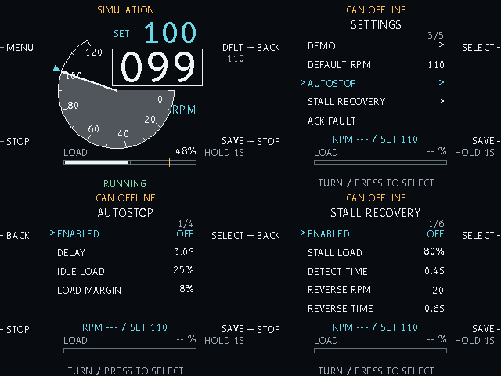

# CoffeeGrinder

A controller prototype for a 71 mm conical-burr coffee grinder, with an
aircraft-instrument-style display, rotary speed control, a load indicator,
autostop and bounded stall recovery.

**The current install runs the display and encoder in offline/demo mode.**
You can try the complete interface without a motor. The CAN motor controller
has separate bench-tested software; connecting it to this display still needs
wiring and timing work. This is not yet a complete grinder you can install
and grind coffee with.



## What you need

- **Raspberry Pi Pico 2**, with headers fitted.
- **Pimoroni Pico Display Pack 2.8** (PIM715, 320×240).
- **Adafruit STEMMA QT rotary encoder** (seesaw product 4991), connected to the
  display's **Qw/ST** socket with a compatible cable.
- A USB **data** cable and a computer with **Python 3.10 or later**.

Attach the display and encoder with power disconnected. The prototype takes
power through USB; the demo needs no motor supply or CAN board.

## Install

### 1. Prepare the Pico once

This version is tested with **CircuitPython 9.2.8 for Raspberry Pi Pico 2**.
If your Pico already mounts as `CIRCUITPY` and has that version, skip to step 2.
The version is shown in `CIRCUITPY/boot_out.txt`.

For a fresh Pico, or one running different firmware:

1. Download the [Pico 2 CircuitPython 9.2.8 UF2](https://downloads.circuitpython.org/bin/raspberry_pi_pico2/en_US/adafruit-circuitpython-raspberry_pi_pico2-en_US-9.2.8.uf2).
2. Hold **BOOTSEL** while connecting the Pico by USB, then release it.
3. Copy the UF2 file onto the bootloader drive that appears. Wait for the
   board to restart and mount as **CIRCUITPY**.

Back up any existing board files before changing firmware. The installer below
copies application files; it does not flash firmware. See the
[CircuitPython installation guide](https://learn.adafruit.com/welcome-to-circuitpython/installing-circuitpython)
for help. Use this project's tested version so the firmware and libraries match.

### 2. Upload the application

Download or clone this repository, open a terminal in its folder, and run:

```sh
python3 tools/install.py
```

On Windows, use `py tools/install.py` if `python3` is unavailable.

The installer finds a connected Pico 2, checks its firmware, downloads and
verifies matching Adafruit libraries, and copies the application, fonts and
licenses. It saves replaced files under `.local/backups/` on your computer.
Other board files and saved RPM/menu settings are preserved. No `pip` packages
are required for installation.

When it finishes, safely eject the drive and reconnect the Pico. The display
should show **CAN OFFLINE**, actual RPM `---`, and an amber LED.

If more than one board is connected, or your drive has a different name,
select its mounted path explicitly:

```sh
python3 tools/install.py --drive /path/to/CIRCUITPY
```

Typical paths are `/Volumes/CIRCUITPY` on macOS, `/media/your-name/CIRCUITPY`
on Linux, and a drive such as `E:\` on Windows.

To inspect the proposed install without changing anything:

```sh
python3 tools/install.py --dry-run
```

For an offline install, download the
[pinned 9.x library bundle](https://github.com/adafruit/Adafruit_CircuitPython_Bundle/releases/download/20261023/adafruit-circuitpython-bundle-9.x-mpy-20261023.zip)
and pass its ZIP file without extracting it:

```sh
python3 tools/install.py --bundle /path/to/adafruit-circuitpython-bundle-9.x-mpy-20261023.zip
```

Run the same installer to update the application later.

## Try the demo

Press **A — MENU**, select **DEMO**, then **RUN DEMO**. Turn the encoder to
select a row and press it, or press **X**, to choose. The screen returns to the
gauge with a permanent **SIMULATION** label; its RPM and load are synthetic.

The default demo accelerates, simulates beans for six seconds, then returns
to an unloaded state. Its menu also offers **ADD BEANS**, **EMPTY HOPPER**
and **SIMULATE JAM** for trying the automatic features. **EXIT DEMO** returns
to offline mode. Press **B — STOP** at any time to stop and cancel recovery.

## Controls

| Control | On the main gauge | In the menu |
| --- | --- | --- |
| Turn encoder | Adjust target by 1 RPM, from 5 to 110 | Choose a row or change the value being edited |
| Press encoder | Start a ready demo, or stop it | Select a row or accept an edit |
| A | Open MENU | BACK; cancel the current edit or leave the page |
| B | STOP and cancel pending recovery | STOP; takes priority over other controls |
| X | Recall the displayed default RPM | Select, like pressing the encoder |
| Hold Y for 1 second | Save selected RPM as the default | Save and apply accepted settings while stopped |

The large white number is **actual RPM**; the smaller cyan number is the
**selected target**. The number beneath **DFLT** is the saved startup RPM.
New boards default to **110 RPM**; updates retain your saved value.

The load bar shows a **current-demand proxy**, not calibrated shaft torque.
Missing measurements show dashes. An amber bar and `HIGH` indicate at least
80% load in the current display scale.

## Autostop and stall recovery

Both features start **off**. In MENU, choose **AUTOSTOP** or **STALL RECOVERY**,
edit the settings, press to accept, then **hold Y to save**. `SAVE TO APPLY`
means changes are still a draft. Stop the demo before applying settings.

| Feature | Behavior | Initial settings |
| --- | --- | --- |
| Autostop | After a sustained beans load, stop when load stays at idle for the selected delay | 3-second delay; idle load 25%, loaded margin 8 percentage points |
| Stall recovery | Detect sustained high demand with low speed; confirm a stop, reverse briefly, confirm another stop, then resume forward | 80% stall demand for 0.4 seconds; reverse target 20 RPM for 0.6 seconds; at most 2 attempts per run |

Autostop needs to observe a loaded batch first, so starting with an empty
hopper does not immediately count as completed grinding. Renewed load resets
its idle countdown. Recovery never clears drive faults, and STOP cancels every
pending restart. A local recovery fault needs an explicit **ACK FAULT** from
the menu after a confirmed healthy stop.

The settings and behavior can be exercised in the demo now. Load thresholds,
physical reversal and grinding performance need commissioning with the
assembled grinder. See the [full controls and settings guide](Software/grinder_ui/README.md)
for ranges and details.

## Status LED

| LED | Meaning in the installed prototype |
| --- | --- |
| Amber | CAN offline |
| Dim blue | Demo stopped |
| Cyan | Demo running |
| Pulsing cyan | Demo transition or autostop countdown |
| Pulsing amber | Recovery or high simulated load |
| Red | Input or motor/automation fault; read the screen message |

## Troubleshooting

| Symptom | What to check |
| --- | --- |
| No `CIRCUITPY` drive | Use a data cable. Install the Pico 2 firmware in step 1 if only a bootloader drive appears. |
| Installer cannot choose a board | Disconnect other boards, or use `--drive` with the mounted drive path. |
| Firmware rejected | Use Pico 2 CircuitPython **9.2.8**, matching the installer and compiled libraries. |
| Blank screen | Check display orientation and header seating with power disconnected, then reconnect after installation. This build is for PIM715. |
| Encoder/input fault | Check the Qw/ST cable and encoder connection, then restart. The original CAN board wiring conflicts with this encoder connection. |
| Settings will not save | Press to accept the edit, stop the demo, then hold Y for a full second. Read the storage message if saving still fails. |
| Motor does not turn | The normal install is offline/demo only; it does not connect or command a real motor. |

## Project status and further reading

The separate CAN work has verified an unloaded 24 V SteadyWin GIM6010-8
prototype up to **110 output RPM**, plus a low-speed secured-fixture current
response. That establishes communication and unloaded speed control, not
coffee-grinding torque. The display and original CAN board share conflicting
GPIO/SPI assignments, and blocking screen redraws exceed the live controller's
servicing deadline. A spacer alone does not complete the integration.

- [Full user guide](Software/grinder_ui/README.md) — menus, settings and wiring.
- [Software/developer guide](Software/README.md) — motor API and integration.
- [Bench commissioning record](Software/bringup/README.md) — diagnostics, measured results and advanced tools.
- [UI design notes](docs/UI_DESIGN.md) — instrument layout and human-factors references.

Application code is distributed under [GPLv3](LICENSE). B612 fonts include
their [SIL Open Font License](Software/assets/fonts/OFL.txt); installed
Adafruit dependencies retain their [MIT licenses](Software/assets/licenses/README.md).
